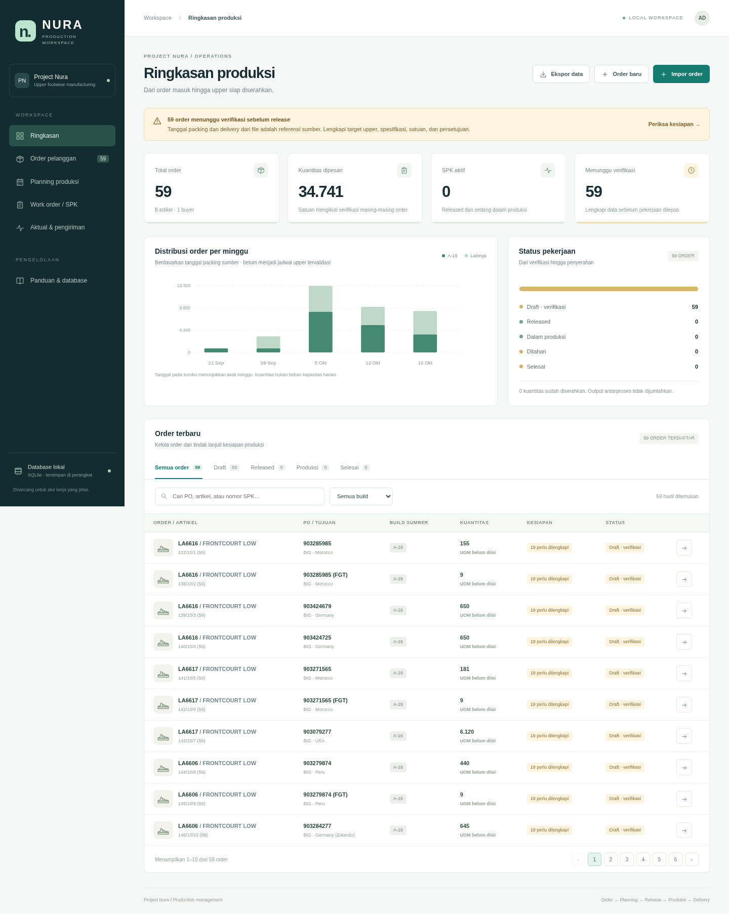

# Project Nura — Production Workspace

Aplikasi web lokal untuk order pelanggan, planning upper sepatu, release SPK, aktual produksi, dan pengiriman. Python/Flask + SQLite, tanpa Node.js, API eksternal, atau layanan database tambahan.

**59 order / kuantitas 34.741** dari `DATA ORDER DAN SPK NURA.xlsx` sudah disertakan sebagai data awal. Seluruh order dimulai sebagai **DRAFT**, tanpa persetujuan dan tanpa jadwal upper yang diasumsikan. Angka Packing/Delivery asli hanya referensi: tanggal itu sama dengan Assembly Finish/PODD pada workbook sebelumnya.



## Menjalankan di PC sendiri

1. Pasang **Python 3.11 atau lebih baru** dari https://www.python.org/downloads/; pada Windows aktifkan pilihan menambahkan Python ke PATH.
2. Unduh repositori GitHub melalui **Code → Download ZIP**, lalu ekstrak seluruhnya. Buka folder `Project Nura - Work Order/SPK/webapp`.
3. **Windows:** klik dua kali `start.bat`. **macOS/Linux:** jalankan `sh start.sh` dari terminal.
4. Browser akan terbuka pada `http://127.0.0.1:5000`. Biarkan jendela terminal berjalan selama aplikasi digunakan. Tekan **Ctrl+C** untuk menghentikan server.

Alternatif untuk semua OS: jalankan `python start.py` (atau `python3 start.py`). Pemasangan pertama membutuhkan Internet untuk dependensi; setelah terpasang, fitur aplikasi berjalan lokal tanpa Internet. Bila port terpakai: `python start.py --port 5050`.

`127.0.0.1` merujuk komputer **yang menjalankan server**. Menjalankan di cloud tidak otomatis membuat aplikasi bisa dibuka dari browser PC rumah. Untuk database di PC rumah, unduh lalu jalankan di PC tersebut. Tidak ada deployment publik dalam proyek ini.

## Fitur dan alur penggunaan

- **Ringkasan:** total order, kuantitas, status, dan grafik referensi packing dari sumber. Grafik sumber bukan bukti kapasitas produksi.
- **Order pelanggan:** pencarian/filter/pagination, size run, tambah order manual, edit draft, CSV. PO diperlakukan sebagai teks. Kuantitas wajib bilangan bulat nonnegatif dan total size harus cocok.
- **Planning produksi:** line internal (terpisah dari build pelanggan), satuan, sistem ukuran, lingkup, BOM/tech pack/QC beserta revisi, target proses dan kapasitas sewing.
- **Work order / SPK:** validasi kelengkapan, release, hold/resume, cetak melalui browser (termasuk Save as PDF), dan penutupan setelah jumlah delivery memenuhi order.
- **Aktual:** cutting → sewing → packing → delivery; hasil tahap berikutnya dibatasi hasil baik tahap sebelumnya. Transaksi memiliki batch, PIC, tanggal, reject, dan rework.
- **Impor XLSX:** preview sebelum simpan, template file terbaru Nura, duplikat identik dilewati, konflik nomor SPK/data ditolak secara atomik. Tidak menimpa order lama, planning, atau approval.
- **Database:** backup SQLite konsisten melalui menu Panduan & database; jejak perubahan tersimpan.

Cara mencoba tanpa mengubah order sumber: buat order kecil baru, isi size run sesuai jumlah, lengkapi Planning & kesiapan, lalu release. Isi aktual berurutan. Untuk delivery pilih proses `delivery`; jenis transaksi mengikuti otomatis. Tutup SPK setelah seluruh kuantitas diterima.

### Aturan release

Isian minimum: line internal, satuan, sistem ukuran, lingkup, referensi BOM, tech pack/pattern, QC, pemberi persetujuan; checklist material/spesifikasi/tanggal; jadwal material → cutting → sewing → packing → delivery; dan kapasitas sewing yang cukup. Tanggal sumber tidak otomatis disalin ke jadwal aktif.

Kapasitas per hari dihitung **Senin–Jumat, tanpa hari libur**, dengan pembagian kuantitas merata selama interval sewing. Release juga memeriksa beban order aktif/hold pada line yang sama (menggunakan kapasitas paling konservatif) dan menolak satuan yang tidak sama saat interval bertumpang tindih. Ini pemeriksaan sederhana, bukan penjadwalan finite-capacity lengkap: tidak mencakup mesin bottleneck, absensi, keterampilan, setup/changeover, atau perbedaan kandungan kerja artikel. Admin tetap harus memverifikasi kelayakannya. Planning terkunci setelah release.

### Aturan aktual

Jumlah masuk harus sama dengan baik + reject + rework; masukkan hanya lot yang sudah selesai diperiksa. Jenis `rework` menyelesaikan saldo rework pada tahap yang sama dan tidak menambah input produksi baru. Baik dari rework dihitung sekali sebagai hasil tahap tersebut. Delivery tidak dapat melebihi packing baik yang belum diserahkan. Transaksi bertanggal lebih awal daripada transaksi terakhir order ditolak agar urutan riwayat terjaga.

Pencatatan versi awal berada pada tingkat **order + proses + transaksi batch**, belum mengendalikan mutasi per-size atau rantai asal setiap bundle. Database menyimpan size run permintaan, bukan saldo aktual size. Produksi pengganti akibat reject, pembatalan transaksi/koreksi saldo, partial release, revisi setelah release, serta penggabungan/pembagian PO harus ditangani melalui pengembangan berikutnya; jangan membuat transaksi fiktif untuk menyeimbangkan saldo. Total kuantitas pada dashboard lintas order tidak mengonversi unit berbeda.

## Database dan backup

Database dibuat otomatis pada `webapp/instance/nura.sqlite3`. Konfigurasi alternatif: environment variable `NURA_DB_PATH` menunjuk file SQLite di folder yang sudah ada. Data awal dimuat satu kali pada inisialisasi database. Membuka aplikasi kembali tidak menambah ulang order sumber yang nomornya telah diedit dan tidak menghapus perubahan. Folder `.venv` dan `instance` tidak masuk Git. GitHub menyimpan kode dan data awal, **bukan** perubahan operasional di database PC.

1. Unduh backup melalui menu **Panduan & database**.
2. Untuk restore, hentikan seluruh proses aplikasi terlebih dahulu.
3. Simpan salinan database saat ini, kemudian salin backup menjadi `instance/nura.sqlite3` (atau path konfigurasi Anda).
4. Jalankan kembali. Simpan backup secara teratur dan jangan mengirim database berisi data usaha ke pihak lain sembarangan.

Aplikasi memakai parameter SQL, transaksi SQLite, validasi server, optimistic locking untuk edit planning/master, CSRF, serta idempotency untuk pengiriman transaksi berulang. Ini bukan sistem multi-user dengan akun/role: nama approver merupakan catatan administratif, bukan autentikasi atau tanda tangan digital. Server mengikat hanya ke `127.0.0.1`; gunakan lokal di perangkat tepercaya. Jangan membuka port ke Internet atau LAN tanpa autentikasi, server produksi, dan desain akses yang sesuai.

## Pengembangan dan validasi

```sh
python -m venv .venv
# Windows: .venv\Scripts\python.exe -m pip install -r requirements.txt
.venv/bin/python -m pip install -r requirements.txt
.venv/bin/python -m unittest discover -s tests -v
.venv/bin/python app.py
```

13 pengujian backend mencakup rekonsiliasi seed, persistensi, CSRF, kelengkapan release, jadwal, optimistic locking, kapasitas antarorder, alur empat proses, rework/idempotency, hold/lock/close, impor atomik, master order, dan backup. Validasi browser dilakukan terpisah pada database uji, bukan dengan membuat transaksi palsu pada database utama.

Data awal tetap belum diverifikasi terhadap PO resmi, dokumen teknik, atau SOP perusahaan. Kelulusan validasi aplikasi tidak membuktikan kebenaran isian pengguna.
